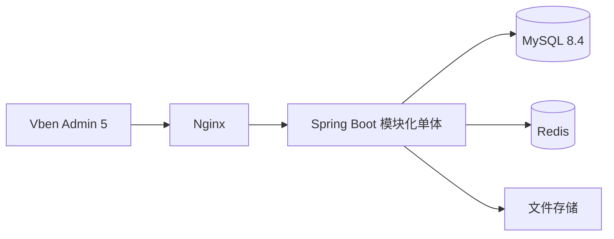

# 技术栈与架构

## 目标与边界

本项目是一套供公司或个人二次开发的后台系统模板。第一版提供通用的认证、组织、权限、系统管理能力，不绑定具体业务领域。默认单租户；需要 SaaS 时另行设计租户隔离扩展。

## 技术栈

| 层 | 选型 | 用途 |
|---|---|---|
| 前端 | Vben Admin 5 `web-antdv-next`、Vue 3、TypeScript、Antdv Next | 管理界面、动态路由、按钮展示控制；优先复用 Vben 通用组件与 playground 示例 |
| 后端 | Java 21、Spring Boot 4.1.x、Spring Security | HTTP API、认证、服务端鉴权 |
| 数据访问 | MyBatis-Plus + 必要的自定义 SQL | 标准 CRUD、分页；复杂列表、树和数据权限查询 |
| 数据库 | MySQL 8.4、InnoDB、utf8mb4 | 权威持久化数据 |
| 数据库迁移 | Flyway | 版本化建表与默认数据 |
| 缓存 | Redis | 一次性登录验证码与登录限流；第一版不缓存权限决策 |
| 接口文档与协作 | springdoc-openapi 3.x、OpenAPI、Apifox | 后端生成契约，Apifox 供前后端协作 |
| 校验与测试 | Bean Validation、JUnit、Testcontainers MySQL | 请求校验、数据库集成验证 |
| 运行监控 | Spring Boot Actuator、Micrometer、Logback | 健康检查、指标与日志 |
| 部署入口 | Nginx | 前端静态资源、HTTPS、API 反向代理 |

Spring Boot 4.1.x 是当前设计基线；具体补丁版及第三方依赖在创建工程时统一锁定，并通过启动与集成测试验证，详见[后端技术栈清单](09-后端技术栈清单.md)。文件存储先定义接口，具体选本地或对象存储由部署场景决定。

## 部署与模块

后端 Maven 根聚合 `admin-base-core` 与 `admin-module-system`；系统聚合目录下包含预留的 `admin-system-api`、业务模块 `admin-system-biz` 和唯一启动模块 `admin-system-start`。业务代码按功能分包，再分 Controller、Service、Mapper、Entity、DTO、VO。所有模块编译进同一个 Spring Boot 应用，只部署一个后端进程；依赖方向与职责见[项目结构](02-项目结构.md)。

## 关键约束

- 标准单表 CRUD 使用 MyBatis-Plus；复杂联表、聚合、树查询和数据权限查询使用明确的 Mapper SQL。分页采用 MyBatis-Plus 分页插件，HTTP 层仍返回模板统一的 `PageResult`。
- 禁止把前端传来的排序列、表名或原始 SQL 片段直接交给 Wrapper；排序字段必须白名单映射。数据权限不能只依赖前端筛选。
- MySQL 是用户、角色、授权、会话和业务数据的权威来源。第一版每次受保护请求查询会话状态及有效授权，不使用可能滞后的权限缓存；Redis 只保存验证码与限流状态，故障时登录失败关闭。
- 前端菜单与按钮控制只负责体验；后端接口必须独立鉴权。
- 每个业务查询明确数据归属字段，并显式应用数据范围。数据范围只合并授予当前操作权限的有效角色，避免其他角色的宽数据范围扩大本次操作。
- 第一版仅 `super_admin` 可授予用户角色、修改角色菜单、接口权限与数据范围，维护菜单和接口权限；普通管理员不得通过创建用户时携带角色绕过该约束。
- 所有数据库变更走 Flyway；不靠手工执行未入库的生产 SQL。
- HTTP 成功响应遵循 Vben 当前请求适配器所需的 `code = 0` 约定。

## 非目标

第一版不内置微服务注册中心、消息队列、分布式事务和多租户隔离。若具体项目需要，再以独立设计扩展。
