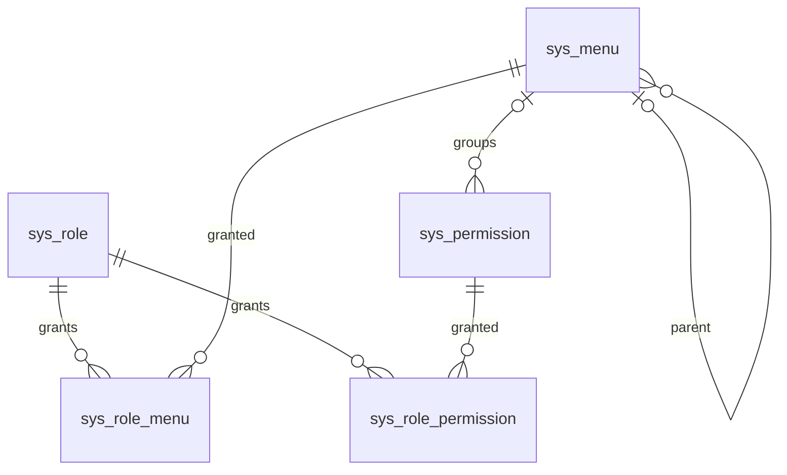

# 菜单与权限拆分架构（V4）

## 目标与边界

遵循 Vben Admin playground 的菜单模型：菜单管理树包含目录 `CATALOG`、页面 `MENU`、页面操作 `BUTTON`、内嵌 `EMBEDDED` 和外链 `LINK`，按钮节点的 `authCode` 即按钮权限码。独立的 `sys_permission` 只存无菜单按钮对应的后端接口权限 `API`。`/menu/all` 返回目录、页面、内嵌和外链路由；`/auth/codes` 合并已授权按钮的 `authCode` 与已授权接口权限码。接口与权限码的绑定仍由后端代码声明，数据库不能配置任意 URL 来改变鉴权。继续使用单体 Spring Boot、MySQL 8.4 和现有角色/数据范围设计。

## 数据模型

- `sys_menu`：`id,parent_id,menu_type,menu_key,route_name,route_path,component,redirect_path,auth_code,title_key,icon,sort_order,route_meta,status,create_time,update_time`。目录、页面、内嵌和外链使用路由字段；内嵌地址存于 `route_meta.iframeSrc`，外链地址存于 `route_meta.link`，只允许 HTTP/HTTPS。按钮只使用 `auth_code`，必须属于目录或页面。根节点必须是目录；普通页面组件只允许已打包的页面。
- 菜单展示配置复用 `route_meta`：`activeIcon`、`badgeType`（点或文字）、`badge`、`badgeVariants`，以及 `keepAlive`、`affixTab`、`hideInMenu`、`hideChildrenInMenu`、`hideInBreadcrumb`、`hideInTab`。菜单编辑时回填，`/menu/all` 原样映射为 Vben 路由元数据；文字徽标必须有徽章内容。
- `sys_permission`：`id,menu_id,permission_key,permission_code,title_key,icon,sort_order,route_meta,status,create_time,update_time`。只存 `API` 权限；`menu_id` 可为空，关联菜单时仅用于分组。按钮权限码只在 `sys_menu.auth_code` 登记，同一码全局不可重复。
- `sys_role_menu(role_id,menu_id)` 授权目录、页面及按钮；`sys_role_permission(role_id,permission_id)` 授权独立 API 权限。获准页面不自动获得其按钮；菜单祖先只在路由树中补齐，不扩大角色显式授权。
- 菜单停用会隐藏其后代页面并使其按钮权限失效；权限停用会立即使对应接口权限码失效。当前会话每次请求仍校验 MySQL 状态。`super_admin` 保留所有有效菜单与权限。

## V4 数据迁移

V1–V3 保持原文件不变。V4–V5 已在本机 MySQL 8.4.6 经 Flyway 执行，创建四张新表，从 `sys_resource` 将 `CATALOG/MENU/BUTTON` 复制到 `sys_menu`，仅将 `API` 复制到 `sys_permission`；旧 `sys_role_resource` 按类型分流。**保留两类节点各自原 ID**，减少授权迁移风险。迁移脚本复制授权后删除旧关系表与旧资源表；Flyway 失败时停止启动。本机执行前已备份开发库。

原资源管理菜单转换成菜单管理；旧 `system:resource:*` 管理权限转为 `system:menu:*`。V5 修正 V4 遗漏的菜单查询/详情 API 权限码。新增权限管理菜单和 `system:permission:*` 权限，只预授权给 `super_admin`。自定义角色的旧授权仅迁移到相应菜单或原权限，不自动获得新增的权限管理入口。

## API 与前端

| 用途 | 路径 | 说明 |
|---|---|---|
| 菜单维护 | `/system/menus/tree`、`/system/menus/{id}`、`POST /system/menus`、`PUT/DELETE /system/menus/{id}` | 目录/页面/按钮/内嵌/外链，菜单管理权限码 |
| 权限维护 | `/system/permissions`、`/system/permissions/{id}`、`POST /system/permissions`、`PUT/DELETE /system/permissions/{id}` | 仅独立 API 权限，权限管理权限码 |
| 角色菜单授权 | `GET/PUT /system/roles/{id}/menus` | 完整 ID 集合原子替换 |
| 角色权限授权 | `GET/PUT /system/roles/{id}/permissions` | 完整 ID 集合原子替换 |
| 当前用户 | `/menu/all`、`/auth/codes` | 路由树和权限码分别查询 |

`web-antdv-next` 菜单管理页参考 `playground/src/views/system/menu`：整页 Vxe 树形表格、顶部新增、行内新增下级/编辑/删除、抽屉表单，菜单树包含按钮及其 `authCode`。目录和页面菜单均可作为上级，支持多级嵌套；按钮、内嵌和外链不能作为上级。页面菜单有子路由时，自身地址仍渲染原页面，进入子地址时渲染子页面。内嵌路由使用 Vben 的 `IFrameView` 与 `iframeSrc`，外链路由使用 `IFrameView` 与 `link`，点击时由 Vben 在新窗口打开。独立 API 权限使用单独列表。角色授权界面分“菜单与按钮授权”和“接口权限授权”，防止误认为勾选页面即获得操作权。

## 保护与验收

- 保护系统管理、菜单管理和权限管理入口及其管理权限，防止超级管理员把管理入口删掉。三个核心菜单允许编辑标题、图标和排序，后端只更新这三个展示字段；路由、层级、状态及权限相关字段保持锁定。普通菜单/权限只有无子节点、无角色引用时可删除。
- 菜单移动校验父级类型、启用状态、无环；路径、路由名和权限码全局唯一。权限的 `menu_id` 只能指向存在的有效菜单。
- V4 核对：原库 34 条资源、34 条授权；新库 29 条菜单、11 条接口权限、29 条菜单授权、11 条接口权限授权。新增 6 条为权限管理入口及权限。旧 `/system/resources` 接口与页面在新代码中移除，Apifox 只维护同一个 OpenAPI 文件。
- 验证 Flyway V4、后端单测/构建、前端类型检查/构建以及真实浏览器的菜单与授权效果。浏览器登录联调独立记录，不能由构建通过代替。
