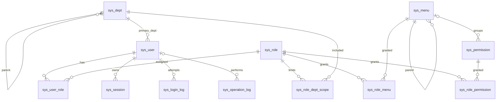

# Vben Admin 5 后端模板：MySQL 数据模型（第一版）

当前模型对应 [`V7__add_dept_remark.sql`](../backend/schema/V7__add_dept_remark.sql)；既有迁移保留为不可修改的历史迁移。目标是单租户、可二次开发的 Spring Boot 模块化单体。`super_admin` 是唯一预置角色；首次管理员账号通过一次性初始化流程创建，初始密码固定为 `12345678` 并强制首次登录改密，不在迁移 SQL 中放明文密码。

## ER 图

部门的 `dept_code` 保留为稳定集成标识，新部门由后端用配置前缀和部门 ID 生成（默认 `DEPT_0001` 格式），已有编码保持不变；`remark` 保存可选备注。只有已禁用且没有子部门、用户归属及角色数据范围引用的部门可以删除。

## 菜单与权限约定

`sys_menu.menu_type` 允许 `CATALOG`、`MENU`、`BUTTON`、`EMBEDDED`、`LINK`。目录、页面、内嵌和外链参与 `/menu/all`；内嵌和外链地址分别存于现有 `route_meta.iframeSrc`、`route_meta.link`。按钮通过 `auth_code` 参与 `/auth/codes` 与后端接口授权。`sys_permission` 只保存没有界面按钮对应的独立接口权限，`permission_code` 同样进入 `/auth/codes`。两表的权限码在应用层保持全局唯一。角色分别通过 `sys_role_menu` 和 `sys_role_permission` 授权。

例如“新增用户”按钮和新增用户接口共用 `system:user:create`，只在 `sys_menu` 中登记一次。页面查询接口如 `system:user:list` 没有按钮，可在 `sys_permission` 中登记。按钮不进入路由树；目录、页面、内嵌和外链按授权生成 Vben 的 `name/path/component/redirect/meta/children`。普通页面组件必须位于后端登记的已打包视图清单，树结构须无环。详见[菜单与权限拆分架构](15-菜单与权限拆分架构.md)。

## 角色与数据权限

普通用户可以有多个启用角色，功能权限取并集。`super_admin` 仅绑定首次初始化的系统账号，不能通过用户管理接口授予员工账号；它在应用层拥有全部功能和数据权限，角色管理接口禁止删除或停用它，并记录其操作审计。

`sys_role.data_scope_type` 的有效值为 `ALL`、`DEPT_AND_CHILDREN`、`DEPT`、`SELF`、`CUSTOM`。`CUSTOM` 的部门集合来自 `sys_role_dept_scope`。一次操作只合并授予该操作权限码的有效角色的数据范围；`ALL` 仅在这些角色中覆盖其他范围。业务查询需要明确归属字段（例如 `owner_user_id`、`dept_id`）才能应用数据范围，不能用通用字符串拼接 SQL。部门下级可先用递归查询获得；量大后再评估闭包表。

## 会话与审计

`sys_session` 存刷新令牌摘要，刷新时轮换并撤销旧会话令牌。第一版每次受保护请求查询 MySQL 会话状态，Redis 只用于验证码和限流，不缓存会话或授权判断。Access Token 保持短有效期。登录日志允许记录不存在的用户名，因此 `user_id` 可为空；删除用户时日志保留。关键操作写入 `sys_operation_log`，不记录密码、令牌或敏感请求体。

## 实施边界

该迁移只覆盖权限底座的核心表。字典、系统参数、文件元数据等应在对应功能开发时添加后续 Flyway 迁移。第一版不增加 `tenant_id`；需要 SaaS 时应单独设计租户隔离版，不通过简单地给部分表补列来实现。
